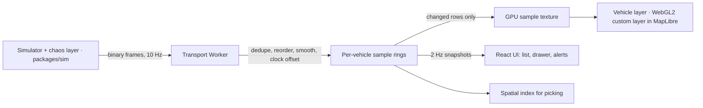

# Fleet Live — design

A dispatcher's live map of **5,000 simulated trucks moving on real Lagos roads**.
The GPS feed arrives the way real telematics does: **late, out of order, twice,
or not at all**. The trucks still glide instead of jumping, and the screen stays
responsive.

> **Status:** design, written before any code (27 Sep 2026). Figures marked
> *target* are goals. Figures marked *computed* are worked out in this document.
> Nothing is *measured* yet, and no measured number will appear until it has
> been produced by a stated script on stated hardware.

---

## 1 · Why this project

**It is frontend-heavy by construction.** The backend is a simulator and a
socket. Everything hard happens in the browser: rendering, time, ordering,
precision, state, accessibility.

**It covers what the listings actually ask for.** These are keyword counts
across the 20 application packs prepared so far. The packs quote each listing
alongside notes, so treat the counts as directional:

| Ask | Packs | Where this project answers it |
| --- | --- | --- |
| Real-time / WebSocket | 11 | Binary socket feed in a Worker; reordering, dedupe, reconnect with resume (§4) |
| State management | 10 | 5,000 updates a second never touch React state (§3) |
| Responsive / mobile-first | 10 | Dispatcher desktop layout; mobile bottom sheet with snap points (§7) |
| E2E tests | 10 | Deterministic Playwright suite: seeded simulator, fixed clock (§9) |
| Accessibility / WCAG | 10 | A map that works without seeing the map (§8) |
| Performance | 9 | GPU interpolation, one draw call, frame budget in a benchmark page (§5) |
| Docs / CI | 9 | ADRs, issue backlog, staged CI, README with GIF (§10) |

**It turns a rare skill into product evidence.** The portfolio already ships
hand-written WebGL2 that replaced three.js (about 185 kB down to 6 kB gzipped).
Here the same skill solves a product problem instead of a visual one.

**It fits a live pipeline.** Class8 (trucking, "real-time data across thousands
of trucks"), and logistics, delivery and mobility companies generally. The
Expo driver app on the roadmap would be the other end of this same simulated
fleet.

---

## 2 · The problem: what the feed does wrong

Real vehicle telematics misbehaves in specific ways. The simulator reproduces
each one on purpose, with a seed, so every behaviour is repeatable:

| Real-world cause | What arrives | Naive map does | This design does |
| --- | --- | --- | --- |
| Mobile network retries | The same ping twice | Nothing visible, or a double step | Drop duplicates by `(vehicleId, seq)` |
| Packets take different paths | Pings out of order | Truck jumps backward | Order by the device's sequence number in a per-vehicle window. A sample that arrives behind the display time is kept and blended in, not dropped, so the track never depends on arrival timing (ADR 0010) |
| Jitter | Pings at uneven intervals | Stutter: fast, stop, fast | **Render slightly in the past** and interpolate between known points (§4) |
| Coverage gap (the device buffers) | Nothing, then a burst | Truck freezes, then races through the backlog | Extrapolate briefly, then mark **stale**. On the burst, skip forward instead of replaying the backlog as animation |
| GPS noise | ±5–10 m scatter | Trucks shiver and drift off the road | Velocity-aided smoothing using the device's own reported speed and heading (the one-euro filter first planned here was measured and lost; see ADR 0010). A toggle overlays the raw pings |
| Device clock skew | Timestamps minutes off | Wrong order, wrong speed | Estimate each device's clock offset as the minimum delay over its window. Order never depends on the clock at all: sequence numbers carry it |
| Socket drops | The connection closes | Blank or frozen map | Reconnect with backoff and jitter. Resume from the last sequence cursor, or take a fresh snapshot if too far behind |

The discipline is the same as in any payments code that has to survive
duplicate or out-of-order events: **the order and multiplicity of arrivals must
not change the answer.** That property is tested directly (§9).

---

## 3 · Architecture



**The one rule: high-frequency data never enters React.** 5,000 pings a second
live in a Web Worker and on the GPU. React renders what people read: the
selected vehicle, list rows and alerts, from snapshots at 2 Hz. A re-render per
ping would spend the frame budget on work nobody can see.

| Piece | Responsibility |
| --- | --- |
| **`packages/protocol`** | Binary codec shared by the server, the Worker and the tests. A ping packs `vehicleId`, `seq`, device time, position as int32 microdegrees (about 0.11 m, exact), speed, heading and flags. The server batches pings into 10 Hz frames: 10 socket messages a second instead of 5,000 |
| **`packages/sim`** | A seeded, isomorphic simulator: trucks on real routes, depots, idling, Apapa port go-slow, and the chaos settings (latency, jitter, duplicate %, reorder window, drop %, coverage-gap zones, clock skew, forced disconnects) |
| **Transport Worker** | Owns the socket, decodes, dedupes, reorders, smooths and estimates clock offset. It writes changed vehicles into the GPU sample texture, maintains the spatial index (`kdbush`), evaluates geofences and raises alerts |
| **Vehicle layer** | A MapLibre custom layer in raw WebGL2. Instanced quads, one draw call, icons drawn in the fragment shader from signed distance fields (crisp at any pixel density, no texture atlas) |
| **React UI** | Next.js App Router shell, search, list, drawer, alerts, geofence tools, replay controls |
| **Two run modes** | **Demo mode** runs the simulator in a Worker, so the public link never sleeps on a free-tier server. **Network mode** runs `apps/sim-server` (Node + `ws`) and proves the real socket path. The chaos layer sits in the transport, so both modes get the same misbehaviour |

**Why Next.js for a client-heavy map.** It provides the routes, the shell, deep
links, headers (CSP), replay route handlers and deployment. The map itself is a
client component loaded with `next/dynamic` and `ssr: false`. The README will
say plainly that Next.js does not server-render the map.

---

## 4 · Time: render in the past, on purpose

Multiplayer games solved this problem long ago with **entity interpolation**:
draw remote objects slightly behind real time, so there are always two known
points to move between.

- **Display time = now − D.** D adapts to how late samples arrive and how far
  apart they are (p95 lateness + p95 interval between pings, clamped to
  1–5 s; built in Layer 4, measured at 1.4 s under default chaos). The UI shows *"as of
  2 s ago"*. A dispatcher is better served by smooth and honest about lag than
  by current and jumping.
- **Interpolation happens on the GPU.** Each vehicle keeps its last 4 corrected
  samples in a row of an `RGBA32F` texture. Every frame, the vertex shader
  fetches that row (`texelFetch`), finds the two samples around display time
  and interpolates. **Per-frame cost lands on the GPU. The CPU touches a
  vehicle only when a ping arrives.**
- **Past the newest sample:** extrapolate from the last velocity for up to 5 s,
  then freeze and fade to *stale* ("last seen 40 s ago"). When a late sample
  finally lands and disagrees with the extrapolation, correct smoothly over
  400 ms instead of snapping.
- **Replay reuses the renderer.** Replay is the same shader with display time
  set by a scrubber and samples loaded from history. There is no second code
  path.

### Two precision traps, and the fixes

**Position.** MapLibre's `defaultProjectionData.mainMatrix` maps
world-normalised Mercator coordinates (0 to 1) to the screen. In Lagos,
x ≈ 0.509. For values between 0.5 and 1, a float32 can only represent steps of
2⁻²⁴ ≈ 6 × 10⁻⁸. Multiplied by the ground distance per Mercator unit at 6.5° N
(about 39,800 km), that is **~2.4 m east–west** (*computed*). At zoom 18,
MapLibre draws about 0.3 m per CSS pixel, so the step is **~8 pixels**. A naive
layer's trucks visibly wobble and drift off roads that MapLibre's own layers
draw perfectly, because MapLibre keeps its tile geometry tile-relative.

*Fix:* **relative-to-centre coordinates.** Upload positions as float32 offsets
from a Lagos origin, which are small numbers with fine steps: millimetres
across the whole metro area. Fold the origin into the matrix on the CPU in
float64 each frame.

**Time.** `Date.now() / 1000` is about 1.7 × 10⁹. Between 2³⁰ and 2³¹, a
float32 can only represent steps of **128 seconds** (*computed*). Passed as a
shader uniform, every truck would freeze and then teleport.

*Fix:* time in shaders is seconds since the session began. After a full day
that is 86,400, where float32 steps are 1/128 s.

Both traps get a unit test that demonstrates the failure with `Math.fround`, so
the reason for each fix sits in the test suite, not in someone's memory.

---

## 5 · Rendering and performance

| Concern | Decision |
| --- | --- |
| Draw calls | One instanced draw for all vehicles. The status shape and colour are computed per instance in the shader |
| Uploads | Only changed rows, batched once per frame with `texSubImage2D` |
| Level of detail | Below zoom 11, icons become density dots, so 5,000 overlapping arrows don't turn into noise |
| Picking | A CPU spatial index in the Worker, refreshed at 10 Hz. Hit radius at least 24 CSS px, which also meets the touch-target guidance |
| Main thread | The socket, decoding and bookkeeping all run in the Worker. The main thread renders and handles input |
| Context loss | Handle `webglcontextlost` and `webglcontextrestored` by rebuilding buffers, programs and textures. Mobile browsers drop WebGL contexts under memory pressure |
| Hidden tab | `requestAnimationFrame` pauses but the Worker keeps receiving. On return, skip to the present instead of animating the backlog |
| Bundle | MapLibre is loaded after the shell. The route budget excludes the map chunk. Sizes are recorded at F0 |

**Targets** (run on stated hardware from a benchmark page, `/bench?n=5000`, that
flies a fixed camera path and records frame times and long tasks):

- p95 frame time under 16.7 ms with 5,000 vehicles.
- No main-thread long task over 50 ms in steady-state live mode.
- A stress run at 20,000 vehicles, reported whatever the result.

CI runs the benchmark only as a smoke test. Its WebGL is a software renderer,
and its frame times mean nothing, so the README will not quote them.

A developer **performance HUD** (FPS, frame time, messages per second, bytes per
second, stale count) is visible in the walkthrough video, so performance is
shown rather than claimed.

---

## 6 · Product scope: the backlog

Each row becomes a GitHub issue with these acceptance criteria.

| ID | Story | Acceptance criteria |
| --- | --- | --- |
| L1 | See the fleet live | 5,000 vehicles move smoothly. Status (moving, idle, stale, alert) shown by **shape and colour**, never colour alone. "As of N s ago" indicator |
| L2 | Find a vehicle | `/` focuses search. Search by plate or driver, with a stale-response guard. Enter selects and flies the map there |
| L3 | Inspect and follow | The drawer shows driver, speed, heading, age of last ping, trip progress and ETA. Follow mode keeps the vehicle centred without jitter |
| L4 | Fleet list | A virtualized, sortable list synced both ways with the map. It is the accessible route to everything the map shows |
| L5 | Filter | Status, depot and speed. Filters **and the map camera** live in the URL, so a copied link reopens the same view |
| L6 | Geofences | Draw a zone (depot, restricted area), or import GeoJSON. Enter and exit alerts use a **20 m margin and a 10 s dwell**, so GPS noise at the edge doesn't fire enter/exit/enter |
| L7 | Alerts | Geofence breach, offline over 2 minutes (10 with the ignition off: the tracker reports less often), speeding (over 60 km/h for 10 s, ending below 55). Acknowledge and resolve. New alerts are announced politely, gathered to at most one announcement every 5 s; vehicle movement never is. See ADR 0012 |
| L8 | Connection truth | Live, reconnecting (with countdown) or offline indicator. Data freshness always visible |
| L9 | Replay | Scrub the last hour. Play at 1×, 10× or 60×. The whole fleet rewinds through the same renderer, list and details panel. Alerts stay live. See ADR 0013 |
| L10 | Raw vs smoothed | Toggle an overlay of the raw pings to see the smoothing at work |
| L11 | Works on a phone | Map full screen, bottom sheet with snap points and drag to dismiss, tap targets at least 24 px |
| L12 | Every state is reachable | Loading, empty (filter matches nothing), stale fleet, disconnected, WebGL unavailable (falls back to the list). All reachable by scenario for tests |

---

## 7 · UI structure and state

| Layer | Holds | Tool |
| --- | --- | --- |
| URL | Filters, camera (`@lat,lng,zoom`), selected vehicle, follow flag. Not replay time: the history lives in the Worker for the session, so a link to 14:05 would open onto a fleet that has no 14:05 (Layer 9). Server-side history would make it possible | Plain `URLSearchParams` and `history.replaceState` (Layer 8a) |
| UI store | Panels, drawer, geofence edit mode, HUD toggle | Zustand, with immutable updates only |
| Worker | Every vehicle sample, the spatial index, geofence state, alerts | Plain typed arrays |
| GPU | Sample texture, instance buffer | WebGL2 |
| Persisted | Geofences and preferences | localStorage (Layer 8b: zones are a few KB, and the synchronous API suits useSyncExternalStore; IndexedDB added async loading states for nothing). Acknowledgements live in the Worker for the session: in demo mode the fleet itself restarts on reload, so they would refer to alerts that no longer exist. The API in network mode |

Layouts:

- **Desktop dispatcher:** list on the left, map in the centre, drawer on the
  right, alert feed docked.
- **Tablet:** the list collapses.
- **Phone:** map full screen with a bottom sheet (peek, half, full).

Components are built in Storybook with every state, including the connection
indicator's three states and the drawer's stale and alerting variants.

---

## 8 · Accessibility: a map that works without seeing the map

Target: WCAG 2.2 AA for everything outside the canvas, plus an equivalent path
for everything on it.

- **The list is the accessible map.** Every vehicle, status and filter is
  reachable from the list. Selection syncs both ways. Nothing is available only
  by pointing at the canvas.
- **Keyboard:** `/` to search, arrows through the list, Enter to select, `F` to
  follow, Escape to clear, `?` to show shortcuts. MapLibre's built-in keyboard
  pan and zoom stay enabled.
- **Announcements:** alerts and connection changes go to a polite live region.
  Positions never do, because announcing movement would be unusable.
- **Status is never colour alone:** each status has its own shape (arrow,
  circle, hollow ring for stale, diamond for alert) and a text label in the list
  and drawer.
- **Reduced motion:** under `prefers-reduced-motion`, vehicles step every 2 s
  without animating, and follow mode moves the camera without easing.
- **Verification:** axe in Storybook and Playwright, plus a documented manual
  pass with NVDA on Windows as part of the definition of done.

---

## 9 · Testing strategy

| Layer | What it proves | Examples |
| --- | --- | --- |
| **Property-based** (fast-check) | Order and duplicates don't change the answer | For any shuffling and duplication of a ping sequence, the buffer ends up identical to the sorted, deduplicated sequence. The codec round-trips any ping |
| **Unit** (Vitest) | Pure logic is right | Bracketing and interpolation, extrapolation cap and stale transition, adaptive delay, velocity-aided smoothing, geofence hysteresis, backoff. Both precision traps shown with `Math.fround` |
| **Component** (Storybook + Vitest add-on) | UI states and interactions, with axe | Drawer (moving, idle, stale, alerting), list, alert feed, connection indicator, HUD |
| **E2E** (Playwright, 3 viewports) | Journeys work end to end | Search, select, follow. A deep link restores camera and selection. List and map stay in sync. Kill the server → "reconnecting" → resumes without a duplicated trail. Reduced motion. Mobile sheet |
| **Visual** | No unintended change | Vehicle layer rendered over a tile-less style with a fixed seed and Playwright's clock, so the pixels are deterministic |
| **Benchmark** | Frame budget | `/bench` on stated hardware; smoke test only in CI |

**Determinism is designed in, not bolted on.** The seeded simulator, the fixed
clock and the tile-less test style mean the same test sees the same trucks in
the same places every run. Flaky map tests are usually a design problem.

---

## 10 · Repository organisation and process

```text
fleet-live/
├─ apps/
│  ├─ web/                  Next.js: shell, map, UI, Storybook
│  │  └─ src/
│  │     ├─ app/            routes: /, /bench
│  │     ├─ features/       live-map · vehicles · geofences · alerts · replay
│  │     ├─ gl/             vehicle layer, shaders (.glsl), precision helpers
│  │     └─ workers/        transport worker, demo-mode simulator worker
│  └─ sim-server/           Node + ws: network mode, history, replay endpoint
├─ packages/
│  ├─ protocol/             binary codec + types
│  └─ sim/                  seeded simulator + chaos layer (isomorphic)
├─ data/routes/             generated Lagos routes (ODbL, attributed)
├─ docs/adr/                one decision per file
└─ .github/                 workflows · issue templates · PR template
```

- **Enforced boundaries:** ESLint import rules. Features don't import each
  other's internals, and nothing outside `gl/` touches WebGL.
- **ADRs:**
  - 0001 Own WebGL2 layer, not deck.gl
  - 0002 Render in the past
  - 0003 Binary protocol, not JSON
  - 0004 Socket in a Worker, React never sees pings
  - 0005 Demo mode for a link that never sleeps
  - 0006 Relative-to-centre coordinates and session time
  - 0007 OpenFreeMap tiles, tile-less test style
- **Visible process:** one issue per backlog row, milestones F0–F5, a Project
  board, small PRs from a template (what, why, screenshot or GIF, test
  evidence, a11y checklist), and conventional commits.
- **CI stages:** typecheck → lint → unit and property tests → component tests →
  build → Playwright with axe → visual diff → bundle budget → deploy Storybook.
  Every PR gets a preview deploy.

### Decisions already weighed

**Own WebGL2 layer rather than deck.gl.** deck.gl is the industry answer and
would be a reasonable production choice. Writing the layer demonstrates the
things deck.gl hides: instancing, GPU interpolation, precision, context loss.
It also builds on the three.js replacement already in the portfolio. ADR 0001
records what switching to deck.gl would cost and buy.

**Interpolate in the past rather than extrapolate first.** Extrapolating
everything is closer to real time but wrong at every turn and every stop, and
corrections look like glitches. Interpolation is always right about the path,
at the cost of a stated lag of 1–5 s.

**Transferred buffers rather than `SharedArrayBuffer`.** Shared memory needs
cross-origin isolation headers, and those complicate loading third-party map
tiles. Transferring buffers from the Worker is fast enough at 10 Hz.

**OpenFreeMap tiles.** Free, no API key, commercial use allowed, attribution
required. That means no secrets in the repo and no quota to exhaust on a public
demo.

**Routes generated once, never at runtime.** The OSRM demo server allows at
most 1 request per second and only reasonable non-commercial use. A script
generates about 300 depot, port and industrial-area routes once, at that rate.
The output is committed with OpenStreetMap attribution under the ODbL.

---

## 11 · Build plan

| Milestone | Scope | Ends with |
| --- | --- | --- |
| **F0 Foundations** | Monorepo, protocol codec and property tests, seeded simulator, route generation, CI skeleton, ADRs, issues and board | Green CI; codec proven |
| **F1 Render** | MapLibre, the vehicle layer (instancing, SDF icons, relative-to-centre coordinates), 5,000 moving vehicles, HUD, level of detail | A GIF of the fleet moving |
| **F2 Real-time correctness** | Transport Worker, dedupe and reorder, rendering in the past on the GPU, extrapolation and stale, smoothing, reconnect with cursor, chaos settings | Chaos on, trucks still glide |
| **F3 Product** | Search, drawer, follow, synced list, URL state, geofences, alerts, responsive layouts, mobile sheet | L1–L8, L10–L12 |
| **F4 Replay** | Server and demo history, binary chunks, scrubber | L9 |
| **F5 Ship** | Full Playwright suite, axe and the NVDA pass, visual diffs, benchmark numbers, Sentry, deploy, README with GIF, two-minute walkthrough | A link and a video to send |

---

## 12 · Known limits

- **The fleet is simulated.** There is no real telematics. The misbehaviours are
  modelled on real ones, but the numbers are the simulator's.
- **No map-matching.** Smoothing reduces noise, but with heavy noise a truck
  can sit a few metres off the road. The raw-ping toggle makes that visible
  instead of hiding it.
- **Demo mode simulates the network** inside a Worker. Network mode is the real
  socket path, and it runs locally with one command.
- **Benchmark figures come from one machine** and will be published with its
  specs. They show the design holds; they are not a fleet-scale guarantee.
- It is not a dispatch product: no authentication, no tenants, no messaging to
  drivers.

---

## Sources

Checked 27 Sep 2026.

- MapLibre `CustomLayerInterface`: <https://maplibre.org/maplibre-gl-js/docs/API/interfaces/CustomLayerInterface/>
  (WebGL2 context, `renderingMode`)
- MapLibre `CustomRenderMethodInput`: <https://maplibre.org/maplibre-gl-js/docs/API/type-aliases/CustomRenderMethodInput/>
  (`defaultProjectionData`, `shaderData`)
- MapLibre custom layer example: <https://maplibre.org/maplibre-gl-js/docs/examples/add-a-custom-style-layer/>
  (`defaultProjectionData.mainMatrix`, `MercatorCoordinate.fromLngLat`)
- OpenFreeMap: <https://openfreemap.org/> (free, no key, commercial use, attribution)
- OSRM demo server policy: <https://github.com/Project-OSRM/osrm-backend/wiki/Demo-server>
  (at most 1 request per second, non-commercial)
