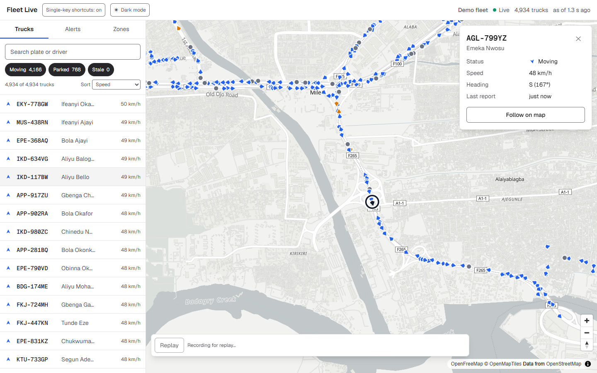
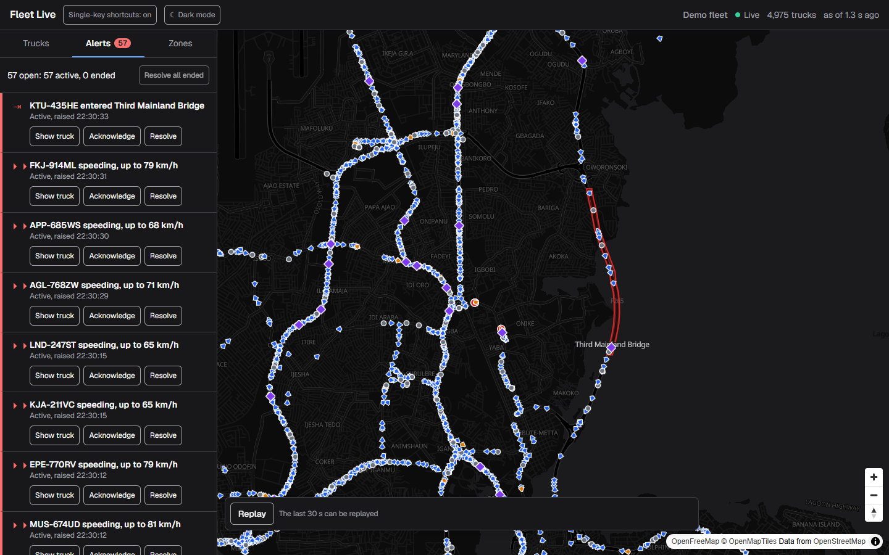
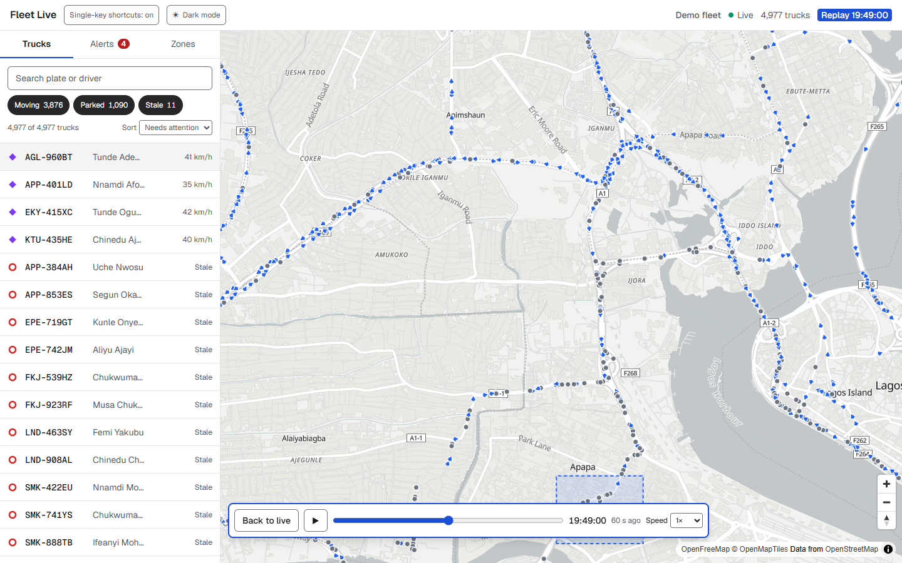
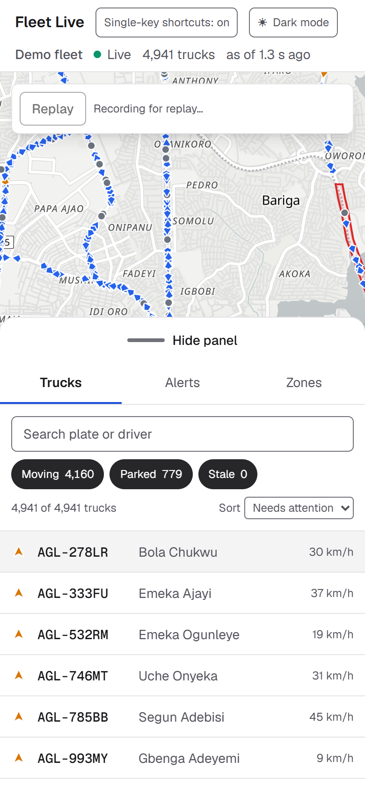
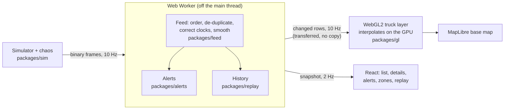

# Fleet Live

A dispatcher's live map of 5,000 trucks on real Lagos roads, drawn smoothly
from a GPS feed that arrives late, out of order, twice or not at all. You can
find and follow any truck, watch for alerts, draw zones, and replay the last
hour.



| Dark mode, alerts | Replay | Phone |
| --- | --- | --- |
|  |  |  |

**Live demo:** _not deployed yet_ (see [docs/DEPLOY.md](docs/DEPLOY.md)).

The trucks, their trackers and the network are simulated: a seeded simulator
drives them on 600 real routes and then makes the feed misbehave on purpose.
Everything after that is what a real system would need. That covers
reordering, de-duplication, clock correction, smoothing, rendering in the
past, reconnecting, alerts and replay.

## What's worth looking at

Every claim here is measured, and each links to where it was measured and why
the decision was made.

| | Result | Where |
| --- | --- | --- |
| **Rendering** | A custom WebGL2 layer interpolates all 5,000 trucks on the GPU every frame: **0–1 long tasks per 10 s**, against 20–29 for the stock GeoJSON layer it replaced, at 60 fps | [ADR 0001](docs/adr/0001-own-webgl-layer.md), [Layer 7](docs/LAYERS.md#layer-7--the-webgl2-truck-layer) |
| **Precision** | Relative-to-centre coordinates and session-relative time, because float32 Mercator in Lagos steps by 2.4 m and float32 epoch seconds step by 128 s | [ADR 0006](docs/adr/0006-rtc-coordinates-and-session-time.md) |
| **A feed that lies** | Order-independent tracks: sequence numbers, not clocks; the earliest duplicate wins; the clock offset is the window's minimum delay. The planned one-euro filter was **measured and rejected**: smoothing with the tracker's own velocity halved the error (moving p50 **2.0 m** against raw GPS 4.0 m) | [ADR 0010](docs/adr/0010-feed-order-independence-and-smoothing.md), [Layer 4](docs/LAYERS.md#layer-4--the-feed-ordering-clocks-and-smoothing) |
| **Connections that drop** | Resume from the last frame, snapshot as the fallback, full-jitter backoff, a silence watchdog and server backpressure: exactly-once delivery across forced disconnects | [ADR 0011](docs/adr/0011-transport-resume-snapshot-backpressure.md) |
| **Alerts that don't cry wolf** | Scored against the simulator's ground truth: **0 false speeding alerts, against 270** for a naive rule; 18 of 18 silent trackers caught; 154 alerts for 154 real crossings of a zone edge drawn through a parking spot, against 1,036 | [ADR 0012](docs/adr/0012-alerts-hysteresis-in-the-worker.md), [Layer 8b](docs/LAYERS.md#layer-8b--alerts-and-geofences) |
| **Replay** | The last hour at 25 MB, through the same renderer. Replayed trucks sit within **1.4 m (p95)** of where the live map drew them | [ADR 0013](docs/adr/0013-replay-from-recorded-estimates.md), [Layer 9](docs/LAYERS.md#layer-9--replay) |
| **Accessibility** | The list is the accessible map: everything on the canvas is reachable by keyboard and screen reader. axe finds **0 violations in 11 states**, and every text and control border meets WCAG AA in light and dark | [Layer 8a](docs/LAYERS.md#layer-8a--find-inspect-follow-list), [NVDA checklist](docs/a11y/NVDA-CHECKLIST.md) |

## How it fits together



In **demo mode** (the default) the simulator runs inside the Worker, so the
app needs no server. In **network mode** the same frames come from
`apps/sim-server` over a WebSocket.

## Run it

Needs Node 22 and pnpm 10.

```sh
pnpm install
pnpm --filter @fleet/web dev          # http://localhost:3000
```

URL options:

| Option | Effect |
| --- | --- |
| `?at=2230` | Start the simulated day at 22:30 Lagos time. Roads are light then, so speeding alerts come within a minute |
| `?n=20000` | A bigger fleet (up to 20,000) |
| `?seed=abc` | A different fleet |
| `?hud=1` | A performance overlay |
| `?layer=baseline` | The stock GeoJSON layer the WebGL layer replaced, for comparison |
| `?mode=network&ws=ws://127.0.0.1:8787/stream` | Network mode, against `pnpm --filter @fleet/sim-server start` |

## Checks

```sh
pnpm check                            # typecheck, lint, 224 unit and property tests
pnpm --filter @fleet/web build && pnpm bundle:size
pnpm --filter @fleet/web start -p 3100 &
pnpm smoke:all                        # every browser check, in Chrome
```

What each check proves, what runs in CI and what is only measured locally
is in [docs/QUALITY.md](docs/QUALITY.md). The evaluations against ground
truth (`pnpm --filter @fleet/<package> evaluate`) are the source of the
numbers above.

## How it was built

One layer at a time, each finished, tested and written up before the next:
why it exists, what it does, how it's engineered, what was measured, and what
went wrong on the way. That's all in **[docs/LAYERS.md](docs/LAYERS.md)**.

- **The design:** [DESIGN.md](DESIGN.md).
- **The decisions:** [docs/adr/](docs/adr/).
- **A five-minute guided tour:** [docs/WALKTHROUGH.md](docs/WALKTHROUGH.md).

```text
packages/
  protocol   binary wire format: 20-byte header + 25 bytes per ping
  routes     600 directed routes between 25 Lagos places, generated once
  sim        seeded trucks, trackers and a misbehaving network
  feed       the correctness core: ordering, clocks, smoothing, estimates
  gl         the WebGL2 layer's data layout, shaders and their TypeScript twin
  transport  the Worker core, the reconnecting socket, demo mode
  alerts     zones, speeding and offline, with hysteresis
  replay     the recorded hour and its playback
apps/
  web        Next.js 16 (App Router), React 19, MapLibre GL, Tailwind v4
  sim-server the same simulator over a WebSocket
scripts/     browser checks, the bundle budget, the frame profiler
```

## Honest limits

- **The data is simulated.** Speeds, traffic, parking times, GPS noise and
  outages are modelled assumptions that are plausible but not measured. The
  routes are real OSRM routes on OpenStreetMap roads.
- **Performance was measured on one laptop:** an i7-10610U with Intel UHD
  integrated graphics, in Chrome. Benchmarks report the minimum and median of
  5 runs, never a single one. CI has no GPU, so there it gates correctness
  and accessibility, but only records timing.
- **The manual screen-reader pass (NVDA) hasn't been done yet.** It's written
  up as a checklist. Automated checks can't replace it.
- **History and replay live in the browser session.** A reload in demo mode
  starts a new fleet.

## Data and attribution

- Route geometry © [OpenStreetMap](https://www.openstreetmap.org/copyright)
  contributors, via the [OSRM](https://project-osrm.org/) demo server,
  licensed under the [ODbL](https://opendatacommons.org/licenses/odbl/1-0/).
- Base map: [OpenFreeMap](https://openfreemap.org/), ©
  [OpenMapTiles](https://openmaptiles.org/), © OpenStreetMap contributors.
- Truck plates and driver names are invented by the simulator.
