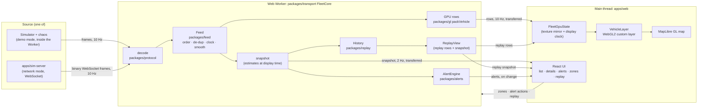

# Architecture

How Fleet Live works, end to end: from a GPS ping leaving a (simulated)
tracker to a truck moving on the screen. Read this before changing anything
that crosses a package boundary.

- **Why** each decision was made is in the [ADRs](adr/) and
  [LAYERS.md](LAYERS.md).
- **Exact formats and settings** are in [PROTOCOL.md](PROTOCOL.md) and
  [CONFIGURATION.md](CONFIGURATION.md).

---

## 0 · Architecture at a glance: type and style

| Question | Answer |
| --- | --- |
| **What kind of system** | A **real-time streaming client**: a thick, data-heavy single-page app that consumes a binary event stream and renders it continuously. The intelligence (ordering, smoothing, alerts, replay) is in the client. A server only has to relay positions |
| **Architectural style** | **Pipes and filters inside an actor.** One Web Worker is an isolated actor that talks only by messages. Inside it, frames flow through a pipeline: decode → feed → estimate → (GPU rows, snapshot → alerts and history) |
| **Concurrency model** | Three contexts that share nothing and pass messages: main thread (UI), Worker (data), GPU (per-truck maths). Large data crosses as **transferred** ArrayBuffers (zero copy) |
| **Data flow** | **One-way, push-based.** Source → Worker → page, at fixed rates: rows 10 Hz, snapshots 2 Hz, alerts on change. The page sends only commands back (zones, alert actions, replay) |
| **State strategy** | **Each piece of state has one owner**, chosen by update rate: high-rate data in the Worker, render data in a GPU-facing mirror, view state in the URL, preferences in storage, UI state in React. See [§5](#5--state-who-owns-what) |
| **Rendering model** | **Render-in-the-past interpolation:** draw about 1.4 s behind the newest data, so each moment sits between two known samples. The GPU computes positions every frame from the 8 samples per truck in a texture |
| **Code organisation** | A **layered monorepo**: small single-purpose packages with one-way dependencies (protocol → routes → sim/feed → gl → alerts/replay → transport → apps). The core logic is framework-free and runs in Node for tests |
| **Deployment topologies** | (1) **Static demo:** the simulator in the browser, no server. (2) **Client + relay server:** network mode, `apps/sim-server` or any server speaking [PROTOCOL.md](PROTOCOL.md). (3) **Production:** device gateway → message bus → stream service → clients, plus API and storage, as proposed in [BACKEND.md](BACKEND.md) |
| **Key patterns** | Ring buffers (history, delay window); serial-number arithmetic (uint32 sequences); typed-array structure-of-arrays (snapshots, alert state); a TypeScript twin of GPU code; debounced hysteresis; resumable streams with snapshot fallback; external stores with `useSyncExternalStore` |
| **Quality strategy** | A seeded simulator gives **ground truth**, so correctness is measured (evaluations), not assumed. Property tests check invariants, and browser checks verify behaviour. See [TESTING.md](TESTING.md) |

### The tech stack

| Layer | Technology | Why |
| --- | --- | --- |
| Language | TypeScript 5 (strict, `noUncheckedIndexedAccess`), ESM | One language for Worker, page, server and tests |
| Monorepo | pnpm 10 workspaces | Fast installs and strict dependency isolation |
| Web framework | Next.js 16 (App Router, Turbopack), React 19 (React Compiler lint rules) | The page shell prerenders as static; the map is client-only |
| Styling | Tailwind CSS 4 with colour tokens in CSS variables | Light and dark from one set of tokens |
| Map | MapLibre GL 5 + OpenFreeMap vector tiles | Open source, no API key; a custom layer hook for our own WebGL |
| Rendering | Raw WebGL2 (GLSL ES 3.0), instanced drawing | 5,000 moving trucks in one draw call (ADR 0001) |
| Background work | Web Worker (module), `postMessage` with transferables | Keeps the main thread free |
| Network | WebSocket (binary frames), `ws` on the server | Low overhead, bidirectional, works through proxies |
| Server | Node.js 22 (`tsx`), a plain `http` server + `ws` | The minimal reference relay |
| Tests | Vitest 5, fast-check (properties), Playwright (browser), axe-core (accessibility) | |
| CI | GitHub Actions | `.github/workflows/` |

## 1 · The problem the architecture solves

A fleet dashboard receives thousands of position reports a second. They're:

- **late:** mobile networks add variable delay;
- **out of order:** a delayed report can arrive after a newer one;
- **duplicated:** devices and networks retry;
- **missing:** reports get dropped, and coverage gaps send nothing, then a
  burst;
- **badly timestamped:** device clocks can be minutes wrong;
- **noisy:** GPS scatters by metres.

The dashboard must still show every truck moving smoothly, never jumping or
running backwards. It has to say honestly when a truck has gone quiet. And
it must not freeze the browser's main thread, which also draws the map and
answers clicks.

The architecture answers with three ideas:

1. **Do the work off the main thread.** Decoding, ordering, smoothing,
   alerts and replay all run in a Web Worker. The main thread only draws and
   handles UI.
2. **Draw the recent past, not the present.** The map renders about
   1.4 seconds behind the newest data (the *display delay*). That leaves a
   known sample on both sides of almost every moment it draws, so
   interpolation replaces guesswork.
3. **Let the GPU interpolate.** The Worker sends each truck's last 8 samples.
   The GPU computes every truck's position every frame, in one draw call.

## 2 · The big picture



There are three execution contexts:

| Context | Runs | Never does |
| --- | --- | --- |
| **Worker** | The frame source (simulator or socket), decoding, the feed, alert evaluation, history recording, replay packing | Touch the DOM or the GPU |
| **Main thread** | React, MapLibre, the WebGL layer's per-frame uniforms and one texture upload, picking on click | Process individual pings |
| **GPU** | Per-truck interpolation, shape choice, colour and status filtering, every frame | Anything stateful |

## 3 · Life of a ping

Follow one report from a truck on Third Mainland Bridge to a pixel.

### 3.1 The tracker sends it

In demo mode the simulator (`packages/sim`) is the tracker. Every 100 ms of
simulated time it moves every truck along its route, using the truck's
acceleration, the time of day and congestion zones. When a report is due
(once a second while moving, every 30 s while parked), it produces a
**ping**:

- vehicle id and sequence number;
- the device's own (possibly wrong) timestamp;
- latitude and longitude with GPS noise;
- speed, heading and flags (ignition on, buffered).

The **chaos channel** then misbehaves on purpose: latency, jitter,
duplicates, drops and reordering.

In network mode the same simulator runs in `apps/sim-server`, which sends
the frames over a WebSocket. A production backend would replace it; see
[BACKEND.md](BACKEND.md).

### 3.2 It travels in a frame

Every 100 ms the source emits a **frame**: a 20-byte header plus 25 bytes
per ping, little-endian. Coordinates travel as int32 microdegrees, and times
as offsets from the frame's base time. Each frame has a sequence number, so
a reconnecting client can ask to resume. Full spec:
[PROTOCOL.md](PROTOCOL.md).

### 3.3 The Worker decodes it

`FleetCore` (`packages/transport/src/core.ts`) owns the source.

- **Network mode:** `SocketSource` wraps `ReconnectingSocket`, with resume,
  full-jitter backoff and a 2 s silence watchdog.
- **Demo mode:** `DemoSource` paces the simulator to the wall clock. Every
  frame is encoded and decoded anyway, so the demo exercises the same codec.

A malformed frame is counted and skipped, never fatal.

### 3.4 The feed makes sense of it

`Feed.ingest(frame)` (`packages/feed`) files each ping into that truck's
`VehicleTrack`. The track's view is a **pure function of the set of samples
it holds**, whatever order they arrived in:

1. **Order by sequence number**, not time, using serial arithmetic across
   the uint32 wrap. A clock that jumps can't scramble a path.
2. **Duplicates keep the earliest arrival.**
3. **Clock offset** = the smallest (arrival − device time) in the window,
   ignoring coverage-gap backlog. Minutes of skew are corrected.
4. **Smoothing** recomputes over the window, using the tracker's reported
   velocity (ADR 0010). It's lazy: it runs only when something reads the
   track.

The feed also adapts the **display delay**: the 95th-percentile lateness
plus the 95th-percentile report interval, clamped to 1–5 s.

### 3.5 Every 100 ms: rows for the GPU

`FleetCore.publishRows()` drains the set of trucks whose tracks changed. For
each one it packs its newest 8 samples into 36 floats (`packVehicle` in
`packages/gl/src/layout.ts`), in 9 RGBA texels:

- 8 texels of samples, each holding x, y, time and heading;
- 1 metadata texel: velocity x and y, flags, and the sample count.

Positions are **Web Mercator offsets from a fixed Lagos origin**. Times are
**seconds since the session epoch**. Both keep float32 precise (ADR 0006).

The rows go to the page in one `postMessage`, with their buffers
**transferred**, not copied. Each truck has a permanent slot, so its texture
row never moves.

### 3.6 Every 500 ms: the snapshot, alerts and history

`FleetCore.publish()` builds a **snapshot**: every truck's estimate at the
display time, as parallel typed arrays (ids, lat, lon, heading, speed, mode,
age, ignition). Before it's transferred to the page:

- the **AlertEngine** evaluates it for zones, speeding and offline
  ([§6](#6--alerts));
- every 5 s of display time, the **History** records a frame of it, for
  replay ([§7](#7--replay)).

### 3.7 The main thread keeps a mirror

`useFleet` (`apps/web/src/features/live-map/use-fleet.ts`) owns the Worker:

- **Rows** go straight into `FleetGpuState`, the page's copy of the GPU
  texture. React never sees them.
- **Snapshots** go to subscribers: the list, the details panel and the
  status bar each take only what they render.
- **Alerts** become React state. They're small and change at most twice a
  second.

### 3.8 Every frame: the GPU draws it

`VehicleLayer` (`vehicle-layer.ts`) is a MapLibre custom layer. Each animation
frame it:

1. reads the display time from `FleetGpuState.displayTime()`. That's the
   live `DisplayClock`, which slews at most 10% and never runs backwards, or
   the replay clock;
2. uploads the texture if rows arrived since the last frame (one
   `texSubImage2D`), and the alert-flag texture if alerts changed;
3. issues **one instanced draw** for the whole fleet, plus at most two
   more: alerting trucks above the rest, then the selected truck on top.

For each truck, the vertex shader (`packages/gl/src/shaders.ts`):

- finds the two samples around the display time and interpolates between
  them;
- past the newest sample, projects forward along the reported velocity for
  up to 5 s, then holds;
- marks the truck stale after 10 s of silence while moving, or 90 s while
  parked;
- tests the status filter;
- turns and sizes the icon.

The fragment shader then draws the shape: an arrow, a dot, a ring, or a
violet diamond for an alert.

The shader's algorithm has a **TypeScript twin**, `gpuEstimate` in
`packages/gl/src/reference.ts`. Picking, follow mode, the replay snapshot
and the tests all use it, so what you click is what you see. A test holds
the twin within 5 cm of the feed's own estimate.

## 4 · Time

| Clock | Where | Meaning |
| --- | --- | --- |
| Device time | In each ping | The tracker's clock. Can be minutes off. Never trusted directly |
| Server time | Frame `baseTime`, `feed.serverTime` | When the source sent the frame. The reference for everything else |
| Corrected sample time | `ResolvedSample.time` | Device time + the estimated offset: when the sample really happened, on the server's clock |
| Display time | `feed.displayTime()`, `DisplayClock.now()` | Server time − the display delay: the moment the map draws |
| Session time | Texture floats | Seconds since the session epoch (the first server time, floored to a second), so float32 stays precise |
| Replay time | `ReplayState`, `FleetCore.replayTime()` | The data time being replayed, run from a wall-clock anchor |

The page doesn't receive a frame every animation frame. `DisplayClock` runs
on the local high-resolution clock between the Worker's 10 Hz reports and is
only steered by them. That's why trucks glide instead of stepping.

## 5 · State: who owns what

| State | Owner | Why there |
| --- | --- | --- |
| Every sample, clock offsets, tracks | Worker, `Feed` | Thousands of updates a second; must not touch the main thread |
| Alert engine state, open alerts | Worker, `AlertEngine` | Evaluated against every truck twice a second |
| The recorded hour | Worker, `History` | 25 MB; only rows and snapshots cross to the page |
| Texture mirror, slot ↔ id map, display clock | Page, `FleetGpuState` | Survives the map losing its WebGL context or swapping style; the layer can be rebuilt from it |
| Selected truck, follow, filters, search, camera | URL (`v`, `f`, `s`, `q`, `c`) | A copied link reopens the same view |
| Tab, drawing, replay controls, open sheet | React component state | Session-only UI |
| Zones, theme, single-key shortcuts | `localStorage`, read with `useSyncExternalStore` | Survive reloads; synchronous to read |
| Alerts list | React state (from Worker messages) | Small, rendered as a list |

## 6 · Alerts

`AlertEngine` (`packages/alerts`) runs in the Worker, on the same snapshot
the map draws.

- **Zones.** Each zone is prepared once: converted to metres on a local flat
  plane, with a grid index over its edges. Each truck gets a signed distance
  to the edge, through a bounding-box rejection and the grid.
- **Hysteresis.** One debounced switch for every edge. It switches only past
  a band (20 m into or out of a zone, over 60 or under 55 km/h), and only
  after the condition holds for 10 s without a break.
- **Offline.** A truck counts as offline after 2 minutes of silence if its
  last report had the ignition on, or 10 minutes if it was off.
- **The alert list.** One open alert per truck, kind and zone. A repeat
  raises the same alert again. Acknowledge and resolve come from the page.

The page receives the open alerts and announces new ones politely, gathered
into at most one announcement every 5 s.

Measured against ground truth: [ADR 0012](adr/0012-alerts-hysteresis-in-the-worker.md).

## 7 · Replay

- **Recording.** Every 5 s of display time, `History` records every fresh
  truck's position at 7 bytes: 16-bit Mercator, heading, speed and
  ignition. It keeps a ring of the last hour.
- **Playback.** In replay, `ReplayView` packs each truck's recorded frames
  around the replay time into the **same GPU rows**. The shader interpolates
  them as it does live.
- **Repacking.** A truck is repacked only when replay time leaves its
  window, and a parked truck only every 45 s.
- **The list and details.** Their snapshot is computed from those rows with
  the shader's algorithm, so the list matches the map exactly.
- **What stays live.** Alerts and recording carry on live underneath.

Measured: [ADR 0013](adr/0013-replay-from-recorded-estimates.md).

## 8 · Failure modes and how they're handled

| Failure | Handling |
| --- | --- |
| Duplicate, reordered or late pings | The feed is order-independent: sequence numbers, earliest duplicate, recompute over the window |
| Wrong device clocks | Offset estimated from the window's minimum delay |
| Coverage gap, then a burst | Buffered pings are flagged and excluded from the clock estimate; the track fills in |
| Truck goes silent | Projected for 5 s, held, then stale (10 s moving, 90 s parked); an offline alert at 2 or 10 min |
| Socket drops | Reconnect with full-jitter backoff. Resume from the last frame if the server still has it, otherwise a snapshot |
| Socket silently dead | The 2 s watchdog: the server sends 10 frames a second even when empty |
| Slow client | The server closes it at 1 MB buffered (code 1013); the client reconnects and resumes or snapshots |
| WebGL context lost | MapLibre destroys custom layers; the page re-adds the layer, which rebuilds from `FleetGpuState` |
| Dark/light style swap | Same as context loss: the truck layer and zone layers are re-added after `style.load` |
| Hidden tab | The pacer caps catch-up at 1 s; simulated time pauses instead of bursting |
| Storage blocked (private mode) | Settings and zones fall back to memory for the visit |
| Bad input (URL, GeoJSON, stored zones) | Parsed strictly; anything invalid falls back to defaults, with an error message for imports |

## 9 · Performance budget

These are measured on the dev laptop (i7-10610U, Intel UHD, Chrome). Details
are in [LAYERS.md](LAYERS.md).

| Where | Cost |
| --- | --- |
| Main thread, truck layer | About 0.1 ms CPU per frame (p50), one draw call, 0–1 long tasks per 10 s |
| Main thread, list | A rebuild of about 2 ms, twice a second, only for the rows on screen |
| Worker, simulator (demo) | About 5–6% of one core for 5,000 trucks in real time |
| Worker, alerts | 0.9–4.4 ms per evaluation, depending on zones, twice a second |
| Worker, replay | Jump 20 ms; 60× playback 3.1 ms per tick; snapshot 37 ms (median) |
| Network (network mode) | About 105 KiB/s per client for 5,000 trucks (Layer 5) |
| Download | 200 KB gzipped up front; map library 271 KB and route data 372 KB later |

## 10 · Code map

```text
packages/protocol/src/   codec.ts (encode/decode), types.ts (Ping, Frame, flags)
packages/routes/src/     places.ts, dataset.ts (validation), geo.ts, polyline.ts
packages/sim/src/        simulation.ts, vehicle.ts, traffic.ts, chaos.ts, random.ts
packages/feed/src/       track.ts (VehicleTrack), feed.ts (Feed), smoothing.ts, seq.ts
packages/gl/src/         layout.ts, shaders.ts, reference.ts (twin), clock.ts, mirror.ts, matrix.ts
packages/transport/src/  core.ts (FleetCore), sources.ts, connection.ts, snapshot.ts, pacer.ts
packages/alerts/src/     engine.ts, hysteresis.ts, geometry.ts, geojson.ts, presets.ts
packages/replay/src/     history.ts, view.ts
apps/sim-server/src/     server.ts (startSimServer), main.ts (CLI)
apps/web/src/
  app/                   layout.tsx (theme script), page.tsx, globals.css (tokens)
  workers/fleet.worker.ts   glue: messages ↔ FleetCore
  features/live-map/     FleetApp (shell), LiveMap, vehicle-layer, panels, ReplayBar
  lib/                   gpu-state, fleet-view, url state, settings, zones, alert text
```
