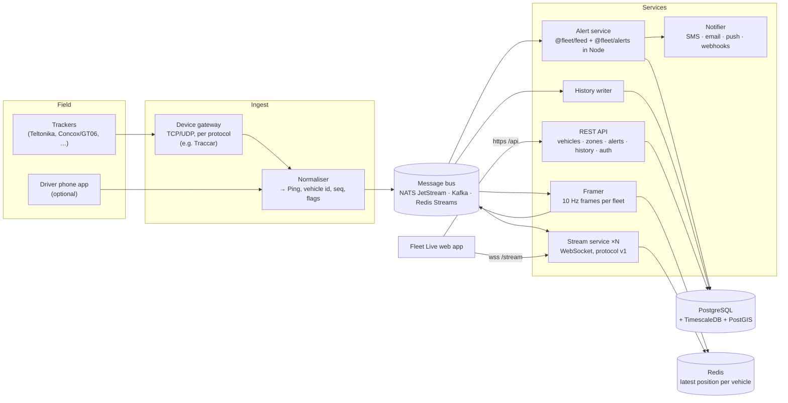

# Backend: from simulation to a real fleet

What it takes to run Fleet Live on real trucks. The client is complete: it
already handles everything a real feed does wrong. The missing piece is
everything behind the WebSocket.

> **Status: proposal.** Nothing in this document is built yet. What exists is
> the client and a reference relay server (`apps/sim-server`) that serves
> simulated data in the production wire format. Estimates are marked, and
> derived from the measured numbers in [LAYERS.md](LAYERS.md).
>
> This document covers the technical backend. Product features, hardware,
> operations, legal and business are in
> [PRODUCTION-READINESS.md](PRODUCTION-READINESS.md).

---

## 1 · What exists, and what's needed

| Concern | Today | Needed for production |
| --- | --- | --- |
| Position source | Seeded simulator | Real trackers through a device gateway |
| Stream to clients | `apps/sim-server`: one process, in memory | A horizontally scalable stream service, per tenant |
| Vehicle registry | `GET /vehicles` from the simulator | A database of vehicles, devices, drivers and fleets, through an API |
| Zones | The browser's `localStorage` | Shared per fleet, stored server-side, through an API |
| Alerts | Evaluated in each browser | Evaluated once, server-side, with notifications (SMS, email, push) and an audit trail |
| History and replay | The last hour, in the browser session | Months of history in a time-series store; replay any period |
| Identity | None (public demo) | Authentication, tenants (one company's fleet), roles |
| Operations | One laptop | Monitoring, alerting, backups, deploys |

The **wire protocol stays the same**. A production stream service speaks
[PROTOCOL.md](PROTOCOL.md) v1, so the client's feed, renderer, list, alerts
display and replay all keep working.

## 2 · Target architecture



Each component has one job, and every arrow is either the bus or a database,
so components scale and fail independently.

## 3 · Ingesting real trackers

### 3.1 The device gateway

Trackers talk binary protocols over TCP or UDP: Teltonika Codec 8/8E,
Concox/Jimi GT06, Queclink, Meitrack and many more. Two options:

- **Use Traccar** (open source, Apache 2.0) as the gateway. It already
  decodes hundreds of tracker protocols. It can forward decoded positions to
  your own endpoint, or you can read them from its API. That's the fastest
  route to real devices; check Traccar's current documentation for the
  forwarding setup.
- **Write protocol decoders** yourself, for the one or two device models the
  fleet uses. That means more control and less to operate, but every new
  device model is new code.

Either way the gateway's output goes to the **normaliser**.

### 3.2 Normalising to a `Ping`

The client's correctness depends on a few fields being right
([PROTOCOL.md §3.3](PROTOCOL.md#33-rules-the-client-relies-on)):

| `Ping` field | Where it comes from | Watch out for |
| --- | --- | --- |
| `vehicleId` (uint32) | Look up the device's IMEI in the registry (`devices` → `vehicles`) | A device moved to another truck: the mapping has validity dates |
| `seq` | The device's own record or serial counter, if the protocol has one (GT06 packets carry a serial number) | **Many protocols have none.** Then assign seq per device in the normaliser: sort each batch by device timestamp (trackers send buffered records oldest first) and continue a persistent per-device counter. Persist the counter, so a restart doesn't reuse numbers |
| `deviceTime` | The record's GPS or device timestamp, **uncorrected** | Don't replace it with arrival time: the client estimates each device's clock offset |
| `lat`, `lon`, `speed`, `heading` | The GPS element | Some devices report km/h or knots: convert to m/s. Discard fixes without a valid GPS lock (satellites = 0) |
| `flags.Ignition` | The ignition input (for example, Teltonika's ignition I/O element; GT06 status bits) | Without an ignition wire, derive from motion, and say so: the 2-minute and 10-minute offline thresholds depend on it |
| `flags.Buffered` | The protocol's "history" or "buffered" marker, or a record more than about 30 s older than its arrival | It keeps backlog out of the client's clock estimate |

Write each normalised ping to the bus, on a subject or topic per fleet, for
example `fleet.<tenantId>.pings`.

## 4 · Streaming to clients

### 4.1 The framer

The protocol wants **one frame every 100 ms per fleet, with a
`frameSeq`**. Clients resume by `frameSeq`, so it must mean the same thing on
every stream node.

- One **framer** per fleet consumes `fleet.<id>.pings`. Every 100 ms it
  encodes what arrived as a frame (`encodeFrame` from `@fleet/protocol`), with
  the next `frameSeq`.
- It publishes the encoded frame to `fleet.<id>.frames`. With a log-based
  bus (JetStream, Kafka, Redis Streams), the log position can *be* the
  `frameSeq`.
- It updates the **newest ping per vehicle** in Redis
  (`HSET fleet:<id>:latest <vehicleId> <ping>`), the source for snapshots.

Run the framer with a leader lock (one active per fleet), so `frameSeq` never
forks.

### 4.2 Stream nodes

Stream nodes are stateless relays and scale horizontally behind a load
balancer. Each one:

1. **Authenticates the WebSocket** ([§7](#7--security-and-privacy)) and finds
   the client's fleet.
2. **Reads the hello.**
   - With `resumeAfter`: replay `fleet.<id>.frames` from that position. Keep
     at least 30 s; minutes is cheap with a log-based bus.
   - Otherwise, or if that position has been dropped: build a Snapshot frame
     from the Redis hash.
3. **Relays live frames as they're published:** the same bytes to every
   client of that fleet.
4. **Enforces backpressure** (close 1013 past a buffer limit) and heartbeats,
   exactly as `apps/sim-server` does. That file is the reference.

Because `frameSeq` comes from the shared log, a client that reconnects to a
*different* node still resumes without loss. Sticky sessions aren't needed.

### 4.3 Capacity (estimates from measured numbers)

Measured: one client of a 5,000-truck fleet receives about **104.6 KiB/s**
(Layer 5). Bandwidth scales with the fleet's report rate, not with the number
of trucks on screen.

| | Estimate |
| --- | --- |
| 100 dispatchers on one 5,000-truck fleet | ≈ 10 MiB/s egress (about 86 Mbit/s) |
| One dispatcher watching 8 hours | ≈ 3 GB per day |
| Larger fleets | Linear in reports per second |

Ways to reduce it, none built or measured yet:

- WebSocket `permessage-deflate` compression;
- sending each parked truck's report only on change;
- **subscription filters** (protocol v2): a client sends its viewport or a
  vehicle group in the hello and receives only matching pings. For fleets
  past about 20,000 vehicles, this is the necessary next step.

### 4.4 Hosting WebSockets

Long-lived WebSockets need a host that keeps processes running: a container
platform (Fly.io, Render, Railway, ECS, Kubernetes) or a VM. **Serverless
functions (including Vercel's) aren't suited to holding WebSocket
connections.** Host the static web app on Vercel and the stream service
elsewhere.

Set the load balancer's idle timeout above the heartbeat interval (10 s),
and allow the upgrade.

## 5 · Persistence

PostgreSQL with **TimescaleDB** (time-series positions) and **PostGIS**
(zones and spatial queries) covers everything in one database.

```sql
-- Who and what
CREATE TABLE tenants  (id uuid PRIMARY KEY, name text NOT NULL, created_at timestamptz DEFAULT now());
CREATE TABLE vehicles (
  id        bigint PRIMARY KEY,           -- the protocol's vehicleId (uint32 range)
  tenant_id uuid NOT NULL REFERENCES tenants,
  plate     text NOT NULL,
  label     text,
  active    boolean NOT NULL DEFAULT true
);
CREATE TABLE drivers  (id uuid PRIMARY KEY, tenant_id uuid NOT NULL REFERENCES tenants, name text NOT NULL, phone text);
CREATE TABLE devices  (imei text PRIMARY KEY, model text, protocol text);
CREATE TABLE device_assignments (          -- which device is in which truck, when
  imei text REFERENCES devices, vehicle_id bigint REFERENCES vehicles,
  valid_from timestamptz NOT NULL, valid_to timestamptz
);
CREATE TABLE driver_assignments (vehicle_id bigint REFERENCES vehicles, driver_id uuid REFERENCES drivers,
  valid_from timestamptz NOT NULL, valid_to timestamptz);

-- Positions: a Timescale hypertable
CREATE TABLE positions (
  vehicle_id  bigint      NOT NULL,
  seq         bigint      NOT NULL,
  device_time timestamptz NOT NULL,
  received_at timestamptz NOT NULL,
  location    geography(Point, 4326) NOT NULL,
  speed_ms    real, heading real, flags smallint,
  PRIMARY KEY (vehicle_id, seq)              -- duplicates are naturally ignored (ON CONFLICT DO NOTHING)
);
SELECT create_hypertable('positions', 'device_time');
-- e.g. keep raw positions 90 days, then a downsampled continuous aggregate

-- Zones and alerts
CREATE TABLE zones (
  id uuid PRIMARY KEY, tenant_id uuid NOT NULL REFERENCES tenants,
  name text NOT NULL, kind text NOT NULL CHECK (kind IN ('restricted','depot')),
  alert_on_enter boolean NOT NULL, alert_on_exit boolean NOT NULL,
  area geography(MultiPolygon, 4326) NOT NULL,
  updated_at timestamptz DEFAULT now()
);
CREATE TABLE alerts (
  id bigserial PRIMARY KEY, tenant_id uuid NOT NULL, vehicle_id bigint NOT NULL,
  kind text NOT NULL, zone_id uuid REFERENCES zones,
  raised_at timestamptz NOT NULL, last_raised_at timestamptz NOT NULL, occurrences int NOT NULL DEFAULT 1,
  active boolean NOT NULL, cleared_at timestamptz, detail double precision,
  acknowledged_at timestamptz, acknowledged_by uuid, resolved_at timestamptz, resolved_by uuid
);
CREATE INDEX ON alerts (tenant_id) WHERE resolved_at IS NULL;   -- the open-alerts list
```

The `alerts` columns mirror the client's `Alert` type
([TYPES.md §5](TYPES.md#5--alerts-and-zones-packagesalertssrcenginets)), so
the UI needs no translation.

## 6 · The API

REST over HTTPS, scoped to the caller's tenant. Shapes follow
[TYPES.md](TYPES.md).

| Method and path | Purpose |
| --- | --- |
| `GET /vehicles` | `VehicleInfo[]`, as today (plus extra fields the UI can ignore) |
| `GET /zones` · `POST /zones` · `PATCH /zones/:id` · `DELETE /zones/:id` | `ZoneSpec` CRUD; accept the same GeoJSON the client exports |
| `GET /alerts?open=true` | The open alerts (the `AlertsMessage.alerts` list) |
| `POST /alerts/:id/acknowledge` · `POST /alerts/:id/resolve` | Alert actions, recorded with the user |
| `GET /history?from=&to=&vehicles=` | Positions for a period, **as protocol frames** (binary), so replay can play months back through the same code path |
| `GET /health` | Liveness, for the load balancer |
| `POST /auth/…` | Sign-in through your identity provider (OIDC) |

Push alert changes to clients either over the existing WebSocket (a new
frame type, which is a protocol v2 change) or with server-sent events from
the API.

## 7 · Security and privacy

- **Transport:** TLS everywhere (`wss://`, `https://`).
- **Authentication:** an OIDC provider (Auth0, Keycloak, Azure AD, Cognito).
  The web app gets a short-lived token.
- **WebSocket authentication:** browsers can't set headers on a WebSocket.
  Options:
  - a secure, HTTP-only, same-site session cookie on the stream domain;
  - a one-time ticket from the API passed in the URL (short-lived, single
    use, kept out of logs).

  Check the `Origin` header either way.
- **Authorisation:** every query and every stream is scoped by `tenant_id`.
  Roles: viewer, dispatcher (acknowledge, resolve), admin (zones, vehicles,
  users).
- **Input:** validate everything: zones through the same rules as
  `parseZones` (`@fleet/alerts` runs in Node), and hello messages as
  `parseHello` does. Rate-limit the API, and cap WebSocket payloads (the
  reference allows 1 KB).
- **CORS:** the reference server allows any origin because its data is a
  public demo. A real API must allow only the app's origin.
- **Privacy:** vehicle positions are often also *a driver's* location, which
  is personal data. In Nigeria the Nigeria Data Protection Act 2023 applies,
  overseen by the Nigeria Data Protection Commission. Before going live:
  - decide and document the lawful basis;
  - tell drivers what is tracked and when (for example, only on duty);
  - set retention periods (the positions table above makes that one policy);
  - restrict who can see history;
  - log access;
  - consider a data protection impact assessment.

  Take legal advice; this is a pointer, not advice.

## 8 · Alerts, server-side

`@fleet/feed` and `@fleet/alerts` are framework-free and already run in Node
(their tests do). So the alert service can run **the same code** the browser
runs today:

A sketch: `bus`, `loadZones` and `persistAndNotify` stand for your
infrastructure.

```ts
import { decodeFrame } from "@fleet/protocol";
import { Feed } from "@fleet/feed";
import { AlertEngine } from "@fleet/alerts";
import { buildSnapshot } from "@fleet/transport";

const feed = new Feed();
const engine = new AlertEngine();
engine.setZones(await loadZones(tenantId));          // from the database; refresh on change
bus.subscribe(`fleet.${tenantId}.frames`, (bytes) => {
  const result = decodeFrame(bytes);
  if (result.ok) feed.ingest(result.frame);
});
setInterval(async () => {
  if (engine.evaluate(buildSnapshot(feed))) await persistAndNotify(engine.drainRaised(), engine.alerts());
}, 500);
```

The semantics then match exactly what was measured
([ADR 0012](adr/0012-alerts-hysteresis-in-the-worker.md)): 0 false speeding
alerts in the evaluation, hysteresis at zone edges, and offline thresholds by
ignition.

**Notifications:** fan out raised alerts to SMS (a local provider such as
Termii, or Twilio), email, mobile push, or customer webhooks. Add per-user
preferences, quiet hours, and escalation when an alert is unacknowledged for
N minutes.

Once alerts are server-side, the browser stops evaluating them. The Worker
receives the alert list from the server instead (a small change in
`FleetCore`), and zones come from the API instead of `localStorage`.

## 9 · Replay from the server

Today replay reaches back as far as the browser has been open. With
`positions` stored, `GET /history` returns frames for any period. The client
can feed them into a `History` (or straight into a `Feed`) and replay through
the existing `ReplayView`, unchanged. Hours of history at full rate are
large, so serve them downsampled: one frame per 5 s per truck, the interval
Layer 9 chose, is 25 MB per hour for 5,000 trucks.

## 10 · Maps

The demo uses **OpenFreeMap**, a free community service. For production:

- keep it (no key, generous use), or
- **self-host vector tiles**: an OpenMapTiles or Protomaps PMTiles extract of
  Nigeria on object storage behind a CDN, with no third-party dependency; or
- use a commercial provider (MapTiler, Mapbox, Stadia) for an SLA.

Keep the attribution visible either way: it's a licence requirement, and
`smoke:ui` checks it.

## 11 · Observability

| Signal | Why |
| --- | --- |
| Pings ingested per second, per fleet; normaliser rejects by reason | Are devices reporting? |
| End-to-end lag (device time → frame sent), p50 and p99 | It sets the client's display delay |
| Frames per second per fleet (must be 10) | Gaps break the client's silence watchdog |
| Connected clients; resume vs snapshot ratio; 1013 closes | Is history long enough? Are clients too slow? |
| Alert evaluation time; alerts raised by kind; notification failures | |
| Devices silent over 10 minutes | Hardware or SIM problems |

Use OpenTelemetry for traces and metrics, with structured logs, and a
dashboard per fleet. A useful SLO is "frames delivered at 10 Hz, 99.9% of
minutes".

## 12 · Changes to the client

| Change | Where |
| --- | --- |
| Stream URL from configuration (for example `NEXT_PUBLIC_STREAM_URL`) instead of the `?mode=network&ws=` URL option | `lib/worker-messages.ts` |
| Sign-in, and pass credentials to the stream and API | New: an auth provider; `SocketSource` |
| Zones from the API | `lib/zones.ts` (keep the same `useZones()` interface) |
| Alerts from the server; acknowledge and resolve through the API | `FleetCore`, `use-fleet.ts` |
| Long-range replay from `GET /history` | `FleetCore` and `ReplayView` input |
| More vehicle fields (driver phone, fleet group) | `VehicleInfo`, `VehicleDrawer` |

Everything else (the feed, the renderer, the list, accessibility) stays as it
is.

## 13 · A phased plan

| Phase | Deliverable | Proves |
| --- | --- | --- |
| 0 | Deploy the demo (static, Vercel) | The client, in public |
| 1 | `apps/sim-server` on a container host, behind TLS; the client in network mode | The stream over the internet: resume, backpressure, mobile networks |
| 2 | Traccar plus a normaliser for 2–5 real trackers; the framer and one stream node | Real devices end to end; the seq and ignition mapping |
| 3 | PostgreSQL schema, REST API, OIDC sign-in, tenants | A product a company could log in to |
| 4 | Server-side alerts and notifications; zones through the API | Alerts that reach someone who isn't looking at the screen |
| 5 | Long-range replay; observability; subscription filters (protocol v2) | Scale and operations |
