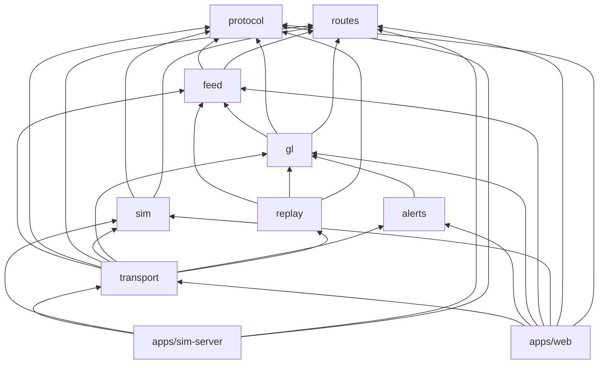

# Package reference

The workspace is a pnpm monorepo:

- eight libraries in `packages/`;
- two apps in `apps/`.

Every package is TypeScript, ESM-only, strict, with
`noUncheckedIndexedAccess`. Packages export their `src/index.ts` directly;
there's no build step. Next.js (Turbopack) and `tsx` compile them on the fly.

The dependencies only point one way: nothing in `packages/` depends on an
app. The two packages that run in the browser's Worker and in Node alike
(`transport`, and everything below it) never touch the DOM.

---

## `@fleet/protocol`: the wire format

**Purpose:** encode and decode frames. Format spec:
[PROTOCOL.md](PROTOCOL.md).

| Export | What it is |
| --- | --- |
| `encodeFrame(frame) → Uint8Array` | Throws `RangeError` on out-of-range input; our own output is a programmer error if bad |
| `decodeFrame(bytes) → DecodeResult` | Never throws: `{ ok: true, frame }` or `{ ok: false, error: { code, message } }` |
| `quantize(ping)` | The ping exactly as a receiver will decode it (microdegrees, cm/s, centidegrees) |
| `Ping`, `Frame`, `FrameType`, `PingFlag`, `PROTOCOL_VERSION`, `HEADER_BYTES` (20), `PING_BYTES` (25) | Types and constants |

**Guarantees, tested as properties:** `decode(encode(f))` equals
`quantize(f)`; `decodeFrame` never throws on arbitrary bytes.

## `@fleet/routes`: the road data

**Purpose:** 600 directed truck routes between 25 Lagos places, generated
once from the OSRM demo server and committed
(`data/lagos-routes.json`, 1.3 MB), with validation and geometry helpers.

| Export | What it is |
| --- | --- |
| `parseDataset(json)` / `validateDataset` | Validate the committed (or any) dataset: places in Lagos, plausible speeds, consistent polylines |
| `PLACES`, `placePairs` | The 25 places (ports, industrial estates, markets, districts) and their ordered pairs |
| `haversine`, `toLocalMetres`, `distanceToSegment`, `EARTH_RADIUS_M` | Geometry on the sphere and on a local plane |
| `decodePolyline`, `encodePolyline` | Polyline6 |
| `simplifyTimedPath` | Douglas–Peucker that keeps per-segment durations |

**Script:** `pnpm --filter @fleet/routes generate` regenerates the data. It
runs at most one request every 1.1 s, caches responses, and rejects snaps
over 500 m. Respect the demo server's policy; see ADR 0008.

## `@fleet/sim`: the simulated fleet

**Purpose:** a repeatable fleet of trucks, trackers and a misbehaving
network, plus ground truth to measure everything else against.

| Export | What it is |
| --- | --- |
| `Simulation` | `advance(ms) → Frame[]` (simulated time, no wall clock), `truth(id)`, `info()`, `vehicles`, `gapZones`, `networkStats` |
| `Vehicle` | One truck: `drive(now, dtMs)`, `report(now, gapZones) → Ping[]`, `truth()` |
| `buildNetwork(dataset)`, `positionAt`, `segmentAt` | Routes as drivable paths |
| `ChaosChannel`, `DEFAULT_CHAOS`, `NO_CHAOS` | The network: latency, jitter, duplicates, drops, reordering |
| `DEFAULT_DEVICE`, `DEFAULT_DRIVERS` | Tracker and driver behaviour ([CONFIGURATION.md §4](CONFIGURATION.md#4--the-simulation-packagessim)) |
| `createRng(seed)`, `Rng.fork(label)` | sfc32 random streams, forked by name |
| `targetSpeed`, `timeOfDayFactor`, `CONGESTION_ZONES`, `TRUCK_MAX_SPEED_MS` | The traffic model |

**Guarantees:**

- **Repeatability:** the same seed gives the same frames, byte for byte.
- **Independence:** randomness comes in named streams
  (`vehicle:<id>:motion`, `:device`, `:identity`, `:habits`, `:power`,
  `zones`, `chaos`). So turning up the chaos never moves a truck, and adding
  trucks never changes existing ones (ADR 0009).
- **Physics:** braking is discrete-time exact (`stoppingLimit`).

**Script:** `pnpm --filter @fleet/sim bench`.

## `@fleet/feed`: the correctness core

**Purpose:** turn a late, duplicated, reordered, badly timestamped stream into
one clean track per truck.

| Export | What it is |
| --- | --- |
| `Feed` | `ingest(frame)`, `estimate(id, displayTime?) → Estimate`, `displayTime()`, `delayMs`, `serverTime`, `vehicleIds()`, `track(id)`, `drainChanged()`, `stats` |
| `VehicleTrack` | One truck's window: `insert`, `resolve() → ResolvedSample[]` (ordered, clock-corrected, smoothed), `estimate(t)` |
| `Estimate` | `{ lat, lon, heading, speed, mode, ageMs, ignition }` |
| `EstimateMode` | `waiting`, `interpolated`, `extrapolated`, `holding`, `parked`, `stale` |
| `velocityAided(gain)`, `raw` | Smoothers |
| `seqDiff`, `seqAfter` | Serial-number arithmetic for uint32 wrap |

**Guarantees (properties):**

- A track's resolved samples depend only on the *set* of pings it has seen,
  not their order.
- Duplicates keep the earliest arrival.
- Clock skew of minutes is corrected.

The smoothing choice was measured: ADR 0010.

**Scripts:** `evaluate` (error against ground truth, per smoother), `bench`.

## `@fleet/gl`: the GPU side

**Purpose:** everything the WebGL truck layer needs that can live outside the
browser: the texture layout, the shaders, and the shaders' TypeScript twin.

| Export | What it is |
| --- | --- |
| `packVehicle(samples, epoch, out, offset)` | One truck's 36 floats: 8 samples of (x, y, t, heading), then (vx, vy, flags, count) |
| `SAMPLES_PER_VEHICLE` (8), `FLOATS_PER_VEHICLE` (36), `VEHICLES_PER_ROW` (200), `TEXTURE_WIDTH` (1800) | Layout |
| `ORIGIN_LNG`, `ORIGIN_LAT`, `mercatorX`, `mercatorY`, `fromOffset`, `METRES_PER_DEG` | Relative-to-centre coordinates (ADR 0006) |
| `VEHICLE_VERTEX_SHADER`, `VEHICLE_FRAGMENT_SHADER` | GLSL ES 3.0 |
| `gpuEstimate`, `slotEstimate` | The vertex shader's algorithm in TypeScript, float32-exact, for picking, follow, replay and tests |
| `MODE_CODES`, `MODES`, `DEFAULT_STALENESS`, `STATUS_GROUPS`, `modeMask`, `groupOf` | Shared numbering for modes and the status filter |
| `SampleMirror` | The page's copy of the texture |
| `DisplayClock` | The display-time clock: slews at most 10%, never backwards |
| `rtcMatrix` | MapLibre's matrix with the origin folded in, in float64 |

**Guarantee:** `gpuEstimate` stays within 5 cm of `Feed.estimate`. Change
the shader and its twin together.

## `@fleet/transport`: the Worker core

**Purpose:** everything that runs in the Worker, testable in Node.

| Export | What it is |
| --- | --- |
| `FleetCore` | Owns a `FrameSource`, `Feed`, `AlertEngine` and `History`. Posts `status` and `snapshot` at 2 Hz, `rows` at 10 Hz, and `alerts` on change. `setZones`, `actOnAlert`, `setReplay`, `replayTime` |
| `FrameSource`, `DemoSource`, `SocketSource` | Demo mode (paced simulator, through encode and decode) or network mode |
| `ReconnectingSocket` | Hello and resume, full-jitter backoff, silence watchdog, status counters |
| `Pacer` | Advances a simulation to the wall clock, catch-up capped at 1 s |
| `buildSnapshot(feed, at?)`, `snapshotTransfer` | Every truck's estimate as transferable typed arrays |
| `WorkerToMain`, `RowsMessage`, `AlertsMessage`, `ReplayRequest`, `HistoryStatus`, `FleetSnapshot` | Message types (see [ARCHITECTURE.md](ARCHITECTURE.md)) |
| `encodeHello`, `parseHello`, `backoffDelay` | Protocol helpers |

The tests drive `FleetCore` with fake timers, and `ReconnectingSocket`
against the real sim server.

## `@fleet/alerts`: zones, speeding and offline

**Purpose:** the alert engine, its geometry and its rules (ADR 0012).

| Export | What it is |
| --- | --- |
| `AlertEngine` | `setZones`, `evaluate(frame) → changed`, `acknowledge`, `resolve`, `resolveCleared`, `alerts()`, `drainRaised()`, `zoneCounts()`, `isActive`, `stats` |
| `DEFAULT_RULES`, `AlertRules` | Margins, dwells, limits ([CONFIGURATION.md §7](CONFIGURATION.md#7--alerts-packagesalerts-default_rules)) |
| `Alert`, `AlertKind` | `zone-enter`, `zone-exit`, `speeding`, `offline` |
| `prepareZone`, `signedDistance` | A zone on a local plane with an edge grid; signed metres to the edge (exact within reach) |
| `debounced`, `step`, `hold` | The band-plus-dwell switch, over typed arrays |
| `parseZones`, `zonesToGeoJSON`, `IMPORT_LIMITS`, `defaultAlerts` | Validating GeoJSON import and export |
| `PRESET_ZONES` | Third Mainland Bridge, Apapa Port |

**Scripts:** `evaluate` (against ground truth, with a naive engine as
comparison), `bench`.

## `@fleet/replay`: the recorded hour

**Purpose:** record the fleet and play it back through the live renderer
(ADR 0013).

| Export | What it is |
| --- | --- |
| `History` | `due(displayTime)`, `record(frame)`, `range()`, `window(id, t)`, `packInto(id, t, epoch, out, offset)`, `recordedAt`, `stats()` |
| `ReplayView` | `update(t, slots) → rows` (only the trucks whose window lapsed), `snapshot(t, slots)`, `invalidateAll()` |
| `DEFAULT_HISTORY` | 5 s frames, one hour |

**Scripts:** `evaluate` (error and memory per interval), `bench`.

## `apps/sim-server`: the network-mode server

The simulator over WebSockets, implementing [PROTOCOL.md](PROTOCOL.md):

- `/stream`, `/vehicles` and `/health`;
- a 30 s resume history;
- snapshots;
- backpressure and heartbeats.

`startSimServer(options)` is used by the tests; `src/main.ts` is the CLI.

## `apps/web`: the dashboard

Next.js 16 (App Router), React 19, MapLibre GL 5, Tailwind CSS 4. See
[WEB-APP.md](WEB-APP.md).

## `scripts/`: browser checks and tools

| Script | Command | What it does |
| --- | --- | --- |
| `smoke-web.mts` | `pnpm smoke:web` | The map draws, fills its area, survives a lost context; frame timing |
| `smoke-ui.mts` | `pnpm smoke:ui` | 22 checks: search, select, follow, filters, list keyboard, deep links, phone, theme, attribution, smoothness |
| `smoke-alerts.mts` | `pnpm smoke:alerts` | 17 checks: zones and alerts end to end, announcements |
| `smoke-replay.mts` | `pnpm smoke:replay` | 11 checks: replay against what the live map drew; speed; stress |
| `a11y.mts` | `pnpm a11y` | axe in 11 states; live regions; status words |
| `contrast.mts` | `pnpm a11y:contrast` | Every text and control border against its painted background, in light and dark, desktop and phone |
| `profile-frames.mts` | `pnpm profile:frames` | A Chrome trace; every slow frame broken down |
| `bundle-size.mts` | `pnpm bundle:size` | The gzipped budget |
| `screenshots.mts` | `pnpm screenshots` | The README pictures |
| `browser.mts` | — | The shared launcher and settings |
