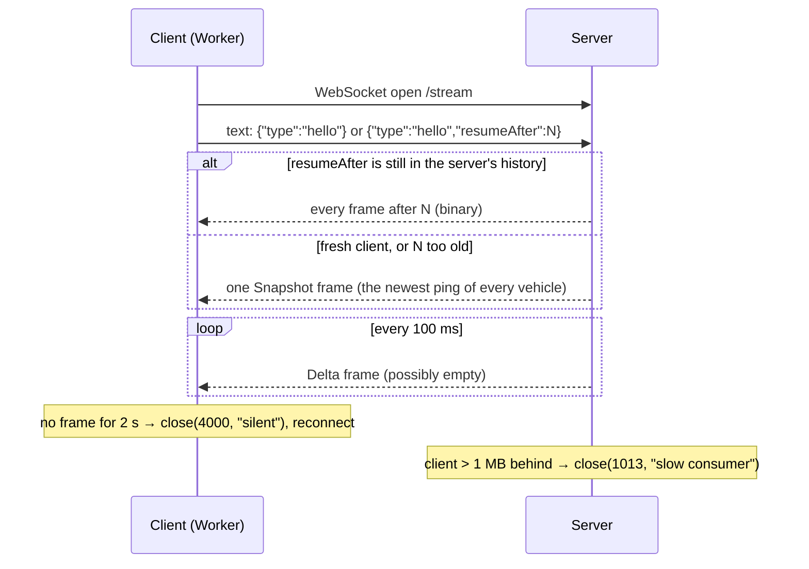

# Wire protocol

The contract between a fleet data source and the Fleet Live client. Anything
that speaks it can drive the map: the bundled simulator server, or a real
backend (see [BACKEND.md](BACKEND.md)).

- **Source of truth:** `packages/protocol/src/codec.ts` and `types.ts`
  (frames), `packages/transport/src/control.ts` (the hello),
  `apps/sim-server/src/server.ts` (the reference server).
- **Rationale:** [ADR 0003](adr/0003-binary-protocol.md) and
  [ADR 0011](adr/0011-transport-resume-snapshot-backpressure.md).

**Version:** 1 (`PROTOCOL_VERSION`).

---

## 1 · Endpoints

A server exposes three things on one host:

| Endpoint | Kind | Purpose |
| --- | --- | --- |
| `GET /stream` | WebSocket (`ws://` or `wss://`) | The live feed: binary frames, 10 per second |
| `GET /vehicles` | HTTP, JSON | The fleet's identities, fetched once by the client |
| `GET /health` | HTTP, JSON | Liveness: `{ "ok": true, "clients": 3, "lastFrameSeq": 81234 }` |

The client derives the `/vehicles` URL from the stream URL:
`ws://host:8787/stream` becomes `http://host:8787/vehicles`, and `wss`
becomes `https`.

### `GET /vehicles`

```json
[
  { "id": 0, "plate": "KJA-482XR", "driver": "Adebayo Okafor" },
  { "id": 1, "plate": "APP-101AB", "driver": "Chinedu Bello" }
]
```

`id` must match the `vehicleId` in pings. The reference server sends
`Access-Control-Allow-Origin: *`, because the data is public demo data. A
real backend must not (see [BACKEND.md §7](BACKEND.md#7--security-and-privacy)).

## 2 · The session



### 2.1 The hello (client → server, once)

The only message a client ever sends: a **text** frame, right after the
socket opens.

| Message | Meaning |
| --- | --- |
| `{"type":"hello"}` | A fresh client: send a snapshot, then live frames |
| `{"type":"hello","resumeAfter":1234}` | A returning client: send every frame after 1234 |

`resumeAfter` is an integer in [0, 2³² − 1]: the last `frameSeq` the client
received. The server:

- closes with **1008 "hello expected"** if no hello arrives within 2 s;
- closes with **1008 "bad hello"** if the hello is malformed or binary;
- ignores any message after the hello;
- refuses messages over 1 KB at the WebSocket level (`maxPayload`).

### 2.2 Resume or snapshot

The server keeps the last 300 frames (30 s at 10 Hz) as encoded bytes.

- **Resume:** if `resumeAfter` is within the server's history (from one
  before the oldest frame up to the newest), it sends each later frame, byte
  for byte. Nothing is lost.
- **Snapshot:** otherwise it sends one frame of type **Snapshot**, holding the
  newest ping of every vehicle, with `frameSeq` set to the newest frame.

A snapshot can overlap what the client already has. That's safe because the
client's feed ignores duplicate `(vehicleId, seq)` pairs and doesn't depend
on order.

### 2.3 Live frames

From then on, the server sends a **Delta** frame every 100 ms, holding the
pings that arrived since the previous frame. **Frames are sent even when
empty.** The steady 10 Hz is how a client tells "no truck moved" from "the
connection is dead".

### 2.4 Closing and keeping alive

| Who | Code | Reason | Client reaction |
| --- | --- | --- | --- |
| Server | 1008 | `hello expected` / `bad hello` | A client bug; still reconnects with backoff |
| Server | 1013 | `slow consumer`: over 1 MB buffered | Reconnect, resume or snapshot |
| Client | 4000 | `silent`: no frame for 2 s | Reconnect immediately into backoff |
| Client | 1000 | Normal stop | — |
| Server | (terminate) | No pong to the 10 s WebSocket ping | — |

The client reconnects with **full-jitter exponential backoff**: a random
delay in [0, min(15 s, 500 ms × 2^attempt)]. The attempt counter resets
after a connection has stayed up for 10 s.

## 3 · Frame format

Binary. **Every multi-byte field is little-endian.** One WebSocket binary
message carries exactly one frame.

### 3.1 Header: 20 bytes

| Offset | Type | Field | Notes |
| --- | --- | --- | --- |
| 0 | u8 | `version` | 1 |
| 1 | u8 | `type` | 0 = Delta, 1 = Snapshot |
| 2 | u16 | reserved | Written as 0, ignored on read |
| 4 | u32 | `frameSeq` | The server's cursor, +1 per frame, wrapping at 2³² |
| 8 | f64 | `baseTime` | Integer epoch milliseconds, the server's clock |
| 16 | u32 | `pingCount` | The number of 25-byte pings that follow |

### 3.2 Ping: 25 bytes, `pingCount` times

| Offset | Type | Field | Unit and range |
| --- | --- | --- | --- |
| 0 | u32 | `vehicleId` | Matches `/vehicles` ids |
| 4 | u32 | `seq` | Per vehicle, +1 per report, wrapping at 2³². A duplicate shares its seq |
| 8 | i32 | `deviceTime − baseTime` | Milliseconds, **signed**: skewed or buffered pings can predate the frame |
| 12 | i32 | `lat` | Microdegrees, [−90, 90]° (about 0.11 m resolution) |
| 16 | i32 | `lon` | Microdegrees, [−180, 180]° |
| 20 | u16 | `speed` | cm/s, [0, 655.35] m/s |
| 22 | u16 | `heading` | Centidegrees clockwise from north, [0, 360)° |
| 24 | u8 | `flags` | Bit 0 `Ignition` (engine on); bit 1 `Buffered` (recorded in a coverage gap, delivered late) |

So a frame is `20 + 25 × pingCount` bytes. Measured with 5,000 trucks, one
client: 10.0 frames/s, 4,274 pings/s, **104.6 KiB/s**, 25.0 bytes per ping
including headers.

### 3.3 Rules the client relies on

- **`deviceTime` is the device's clock, uncorrected.** The client estimates
  each device's offset itself. A server must not "fix" it.
- **`seq` orders a vehicle's reports, not time.** Increment it by exactly 1
  per report the device makes, including reports that are later dropped. A
  gap in seq is how a missed report is known.
- **Duplicates are fine; the client de-duplicates.** Re-sending a ping is
  always safe.
- **Order within and across frames doesn't matter.** Late pings may arrive
  in any later frame.
- **Set `Buffered` on backlog** from a coverage gap. The client keeps those
  pings out of its clock estimate, because they are late by design.
- **Set `Ignition`** whenever the engine is on. The client uses it to decide
  "parked" (with speed under 0.5 m/s) and which offline threshold applies
  (2 min with the engine on, 10 min off).

### 3.4 Decoding is defensive

`decodeFrame` returns a result instead of throwing. It rejects:

| Code | When |
| --- | --- |
| `too_short` | Fewer than 20 bytes |
| `unsupported_version` | `version` ≠ 1 |
| `unknown_frame_type` | `type` not 0 or 1 |
| `length_mismatch` | The byte length ≠ `20 + 25 × pingCount` |
| `invalid_base_time` | `baseTime` not a finite integer |
| `value_out_of_range` | A decoded coordinate, speed or heading out of range |

A rejected frame is counted (`badFrames` in the status) and skipped. The
connection stays up.

## 4 · Implementing a compatible server

A server in any language needs to:

1. Accept a WebSocket at `/stream` and wait up to 2 s for the text hello.
2. Keep a ring of the last N encoded frames (300 is the reference), and the
   newest ping per vehicle.
3. Every 100 ms, encode the pings received since the last frame as a Delta
   frame with the next `frameSeq`, append it to the ring, update the
   newest-per-vehicle map, and send it to every live client. Send it even if
   it's empty.
4. Close clients whose send buffer passes a limit (1 MB in the reference)
   with code 1013.
5. Ping clients every 10 s and terminate those that don't pong.
6. Serve `/vehicles` (and ideally `/health`).

Encoding sketch (pseudocode, little-endian throughout):

```text
buf = bytes(20 + 25 * n)
u8(0, 1); u8(1, type); u16(2, 0); u32(4, frameSeq); f64(8, baseTime); u32(16, n)
for i, p in pings:
  o = 20 + 25 * i
  u32(o, p.vehicleId); u32(o+4, p.seq)
  i32(o+8, p.deviceTime - baseTime)
  i32(o+12, round(p.lat * 1e6)); i32(o+16, round(p.lon * 1e6))
  u16(o+20, round(p.speed * 100)); u16(o+22, round(p.heading * 100) % 36000)
  u8(o+24, p.flags)
```

`apps/sim-server/src/server.ts` (about 240 lines) is the reference
implementation, and its tests in `packages/transport/tests` drive it with a
real client.

## 5 · Evolving the protocol

- **Additive change** (a new flag bit, use of the reserved u16): keep
  `version` 1. Old clients ignore unknown flag bits; document the bit here.
- **Breaking change** (a new ping layout or a new field): bump `version` to 2.
  Old clients reject the frames (`unsupported_version`) instead of
  misreading them. A server that must serve both should negotiate in the
  hello, for example with an added `"version": 2` field. Old clients don't
  send it, so the server falls back to v1.
- **Update together:** `codec.ts` and its property tests (round trip, and
  never throwing on random bytes), this document, and the reference server.
